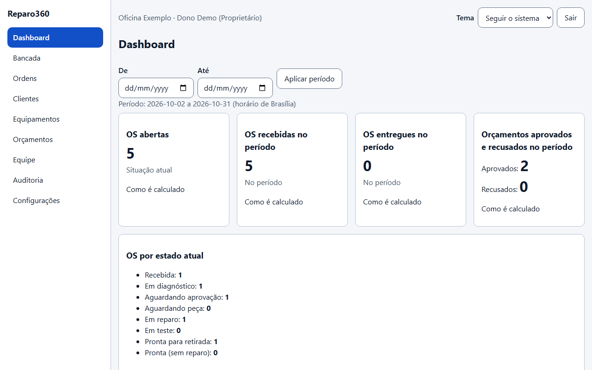
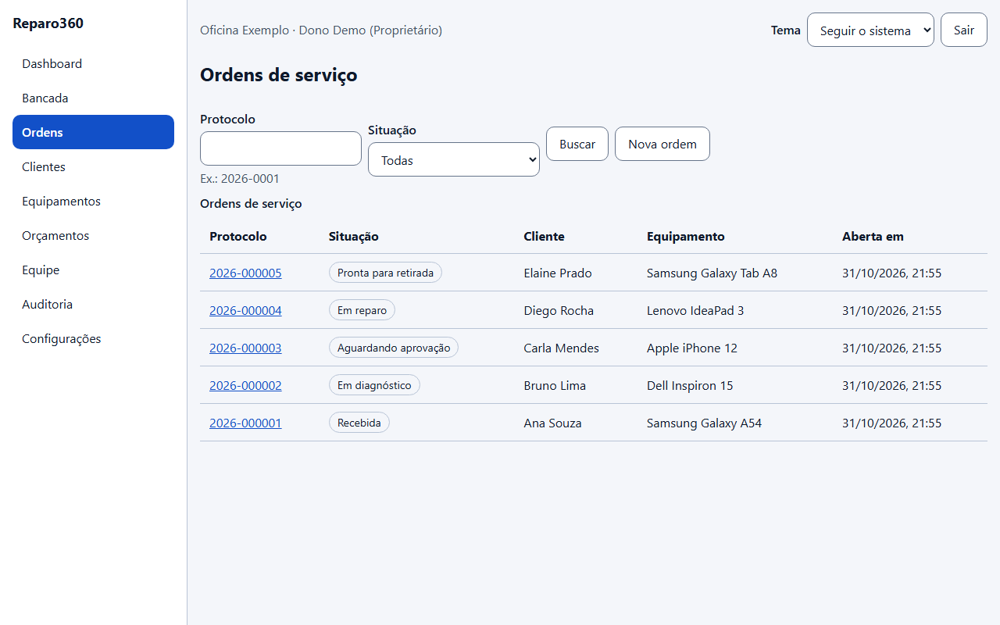
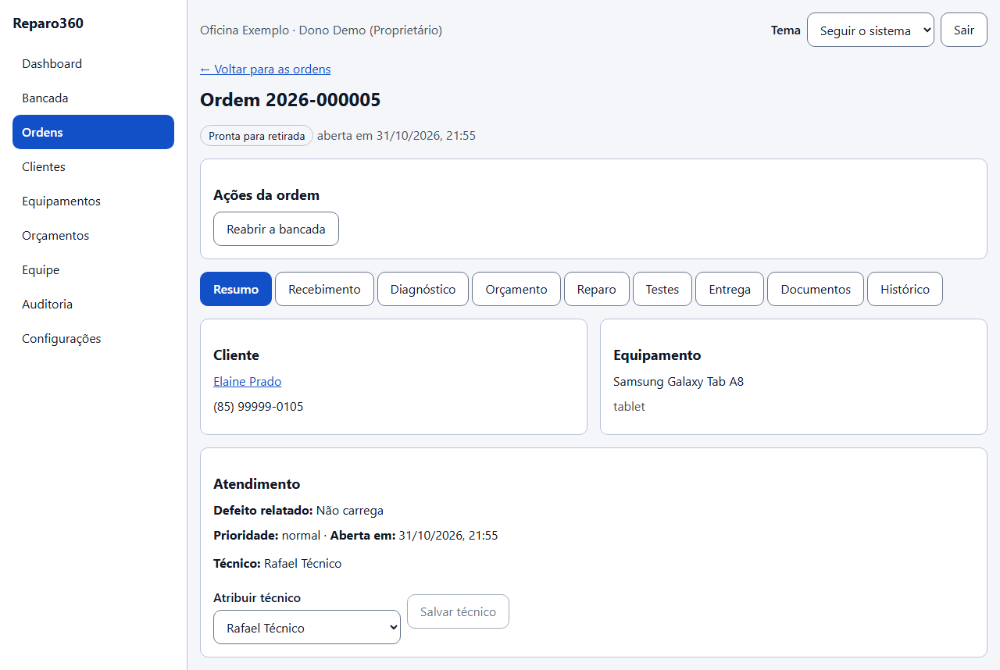
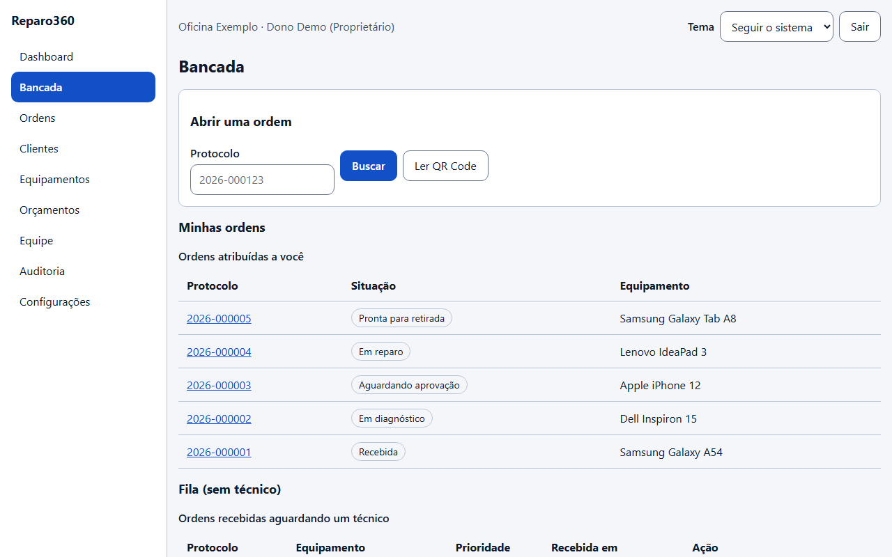
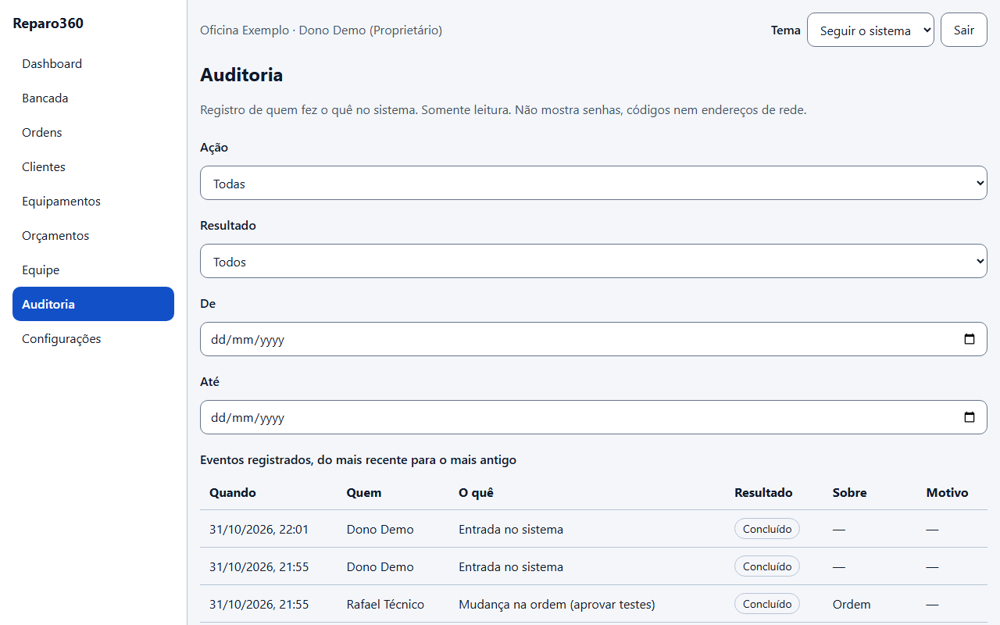
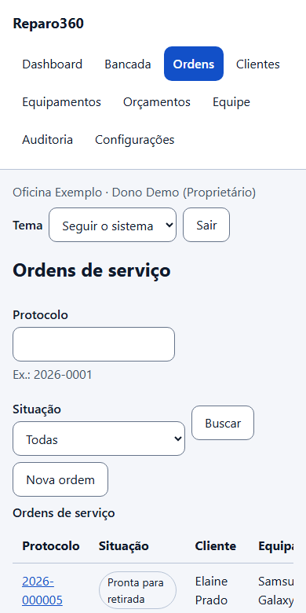

# Reparo360

**Gestão de assistências técnicas com rastreabilidade de ordens de serviço, QR Code e portal de acompanhamento.**

> **Status:** projeto em desenvolvimento e validação técnica. O sistema ainda **não está pronto para operação comercial com dados reais**, e há decisões de implantação, segurança e revisão jurídica pendentes.  
> **English:** Repair-shop management platform with work-order tracking, QR codes and a read-only customer portal. **Work in progress; not production-ready.**

## Visão rápida | Project overview

O Reparo360 foi concebido para lojas de manutenção de celulares, computadores, notebooks e outros eletrônicos. O objetivo é registrar o que foi recebido, documentar o diagnóstico, apresentar orçamentos versionados e acompanhar cada etapa até a entrega.

- **Equipe:** cadastro de clientes e equipamentos, abertura de ordem de serviço com recebimento e fotos, diagnóstico, orçamento versionado (valores digitados em reais, guardados em centavos inteiros), decisão presencial, reparo, testes finais, entrega, encerramento, documentos em PDF, etiqueta com QR Code, indicadores e gestão da equipe (somente proprietário e gerente, com confirmação de senha).
- **Consumidor:** link individual com QR Code para acompanhar o estado do serviço pelo navegador, **em modo somente leitura** nesta fase.
- **Gestão:** permissões por função, trilha de eventos e separação de dados entre empresas.
- **Evolução:** regras de negócio documentadas, testes automatizados e relatórios das fases de desenvolvimento.

## Veja funcionando

Capturas de tela de uma assistência de demonstração (todos os dados são fictícios), geradas com `scripts/demo-seed.mjs`.

| | |
| --- | --- |
|  **Dashboard:** indicadores e ordens por estado |  **Ordens de serviço** em cada etapa do fluxo |
|  **Ordem:** recebimento, diagnóstico, orçamento, reparo, testes e entrega |  **Bancada** do técnico e fila sem técnico |
|  **Auditoria** consultável, sem IP nem identificadores internos |  **Celular:** a interface se adapta à tela do celular |

### Roteiro de demonstração (uns 5 minutos)

1. **Subir o sistema** com o Docker: `instalador/LEIA-ME.md` (Windows, por `.exe`) ou a seção de desenvolvimento abaixo. A API serve a interface quando `WEB_DIST` aponta para `apps/web/dist`.
2. **Criar uma assistência de demonstração** em `/master` (**Criar assistência**: o Master gera uma senha temporária, mostrada uma vez, e o proprietário é obrigado a trocá-la no primeiro acesso). Para uma demo rápida, também dá para iniciar a API com `ALLOW_PUBLIC_ONBOARDING=true` e cadastrar a assistência por `POST /api/v1/tenants`; **não deixe isso ligado fora do seu computador**.
3. **Carregar dados fictícios** (5 clientes, 5 ordens em etapas diferentes e um técnico):

   ```bash
   DEMO_EMAIL=<e-mail do proprietário> DEMO_PASSWORD=<senha dele> node scripts/demo-seed.mjs
   ```

4. **Percorrer:** Dashboard → Ordens (cada etapa do fluxo) → uma ordem (abas de recebimento a entrega, orçamento versionado, PDF e etiqueta com QR Code) → Bancada → Equipe (papéis e permissões) → Auditoria.
5. **Mostrar o isolamento:** crie uma segunda assistência e confirme que ela não enxerga nada da primeira (a regra está no banco, por Row Level Security, e é coberta por testes).

## Tecnologias

| Camada | Tecnologias |
| --- | --- |
| Web | React, TypeScript, Vite, React Router |
| API | Node.js, TypeScript, Fastify, Zod |
| Dados | PostgreSQL 17, Drizzle ORM |
| Testes e qualidade | Vitest, Testing Library, axe-core, ESLint, TypeScript |
| Infraestrutura local | Docker Compose, pnpm workspaces |
| Documentos | PDFKit, QR Code |

## Engenharia e decisões técnicas

- **Monólito modular multiempresa:** separação entre API, interface, domínio e persistência.
- **Isolamento de dados:** autorização por função e políticas de Row Level Security (RLS) no PostgreSQL, com testes documentados.
- **Integridade de fluxo:** transições controladas de ordens, eventos auditáveis e tratamento de operações repetidas.
- **Portal com acesso restrito:** token individual revogável; o consumidor acompanha a OS e, quando a assistência configura o envio de e-mail, aprova ou recusa o orçamento com um código de uso único enviado ao e-mail cadastrado.
- **Senhas por e-mail:** recuperação de senha e convite de membros (links de uso único, resposta que não revela se a conta existe), quando o envio de e-mail está configurado.
- **Testes de navegador:** roteiros em Chromium (Playwright) para entrada, cadastro, ordem de serviço, Master e recuperação de senha.
- **Auditoria consultável:** proprietário e gerente veem quem fez o quê (sem IP nem identificadores internos), com filtros e paginação.
- **Administração da plataforma (Master):** área separada, com senha e segundo fator (TOTP); lista, suspende e reativa assistências e cria novas com senha temporária de troca obrigatória. Não tem acesso a dados de clientes.
- **Qualidade verificável:** testes automatizados contra PostgreSQL real (530 na última execução local, em 2026-10-31, mais 5 testes de navegador), tipos, lint, limite de tamanho de arquivo, build, auditoria de dependências, varredura de segredos (gitleaks) e CodeQL, executados no GitHub Actions a cada envio. Resultado de uma execução não é garantia de ausência de defeitos.
- **Backup verificável:** backup de banco e anexos, com conferência por SHA-256, opção de cifragem e prova de restauração em banco descartável.
- **Instalação local no Windows:** `Instalar-Reparo360.exe` (guia em `instalador/LEIA-ME.md`). Os executáveis não são assinados digitalmente.
- **Interface por papel:** as telas e ações mudam conforme a função (proprietário, gerente, atendente, técnico), mas quem decide é sempre o servidor.
- **Valores em dinheiro:** a pessoa digita em reais; o sistema guarda centavos inteiros para evitar erros de arredondamento e recalcula o total no servidor.

## Estrutura do repositório

```text
apps/
  api/        API e regras de aplicação
  web/        Interface, painel, bancada e portal
packages/
  domain/     Regras e contratos do domínio
  database/   Esquema, migrações e acesso aos dados
docs/
  product/       Requisitos e fluxos do produto
  architecture/  Arquitetura e modelo de dados
  security/      Modelo de ameaças, permissões, plano de testes de segurança, backup e incidentes
  reports/       Evidências e limites de cada fase
infra/          Ambiente local (PostgreSQL em Docker)
instalador/     Instalador e scripts de uso local (Windows)
scripts/        Backup, verificação de restauração, medições e dados de demonstração
```

## Executar verificações em ambiente de desenvolvimento

Pré-requisitos: Node.js >= 22, pnpm 11 e Docker. Necessário configurar as senhas e os caminhos do ambiente local em um arquivo `.env` **não versionado**, a partir de `.env.example`.

```bash
pnpm install --frozen-lockfile
pnpm typecheck
pnpm lint
pnpm test
pnpm build
```

Para testes que usam banco real, prepare antes o PostgreSQL do `docker-compose.yml`, as variáveis de ambiente e as migrações conforme a configuração local. Não execute o sistema com senhas de exemplo.

## Limites conhecidos — leia antes de usar

- A aprovação remota por e-mail **não foi testada com um provedor de e-mail real**; sem envio configurado, só existe a aprovação presencial.
- Instalação do PWA, leitura de QR em aparelho físico, Lighthouse e testes de ponta a ponta em navegador real ainda não foram feitos.
- Existem pendências de retenção de dados, armazenamento de arquivos fora do disco local, revisão jurídica, recuperação de senha e preparação para piloto.
- É uma instalação **local**: hospedagem, HTTPS e criptografia em repouso ainda não foram definidos.
- Não há declaração de conformidade formal com LGPD nem recomendação de uso em produção com dados pessoais reais.

Antes de qualquer implantação, consulte as [decisões pendentes](docs/DECISOES_PENDENTES.md), o [modelo de ameaças](docs/security/THREAT_MODEL.md), o [plano de testes de segurança](docs/security/SECURITY_TEST_PLAN.md) e os [relatórios de cada fase](docs/reports/). Os limites estão ali declarados de forma aberta.

## Autor e projetos relacionados

Criado por **Maycon Meneses** — [GitHub](https://github.com/MayconMeneses) · [LinkedIn](https://www.linkedin.com/in/maycon-meneses/) · [Portfólio](https://mmsystem.tech/comercial).
